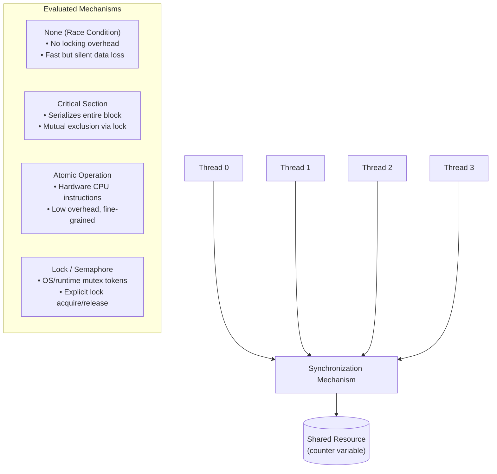

# Experiment 5: Synchronization Mechanisms in Parallel Programs

- **Course:** Parallel & Distributed / GPU Computing Laboratory
- **Target OS:** Ubuntu 22.04 LTS (Linux / VMware / WSL)
- **Compiler:** GCC (build-essential) with OpenMP (`libgomp`) & POSIX Threads (`pthread`)
- **Workload:** 1,000,000 Shared Counter Increments across 1, 2, 4, and 8 Threads

---

## 1. Objective

To implement and study common synchronization mechanisms used in shared-memory parallel programs:

1. Unsynchronized (Race Condition) update
2. Critical sections (`#pragma omp critical`)
3. Atomic operations (`#pragma omp atomic`)
4. Barriers (`#pragma omp barrier`)
5. Semaphores / Locks (`sem_t`, `omp_lock_t`)

The goal is to evaluate their correctness, execution time, and scalability as the thread count increases from 1 to 8.

---

## 2. Theory & Synchronization Concepts

### 2.1 Why Synchronization is Needed

In shared-memory parallel architectures, multiple concurrent threads read and write to the same memory addresses. When multiple threads execute a read-modify-write operation (such as `counter++`) concurrently without coordination:

1. Thread A and Thread B read the same initial value of `counter` simultaneously.
2. Both threads compute `value + 1` in their local registers.
3. Both write back the same value to memory.

As a result, one or more increments are silently lost. Synchronization primitives coordinate memory access to ensure consistent and correct execution regardless of thread scheduling.

### 2.2 Mechanism Overview



- **Race Condition (`race.c`):** No synchronization is applied. Counter updates collide across threads, leading to non-deterministic, incorrect results.
- **Critical Section (`critical.c`):** Enforced via `#pragma omp critical`. Only one thread can enter the designated block at any moment. While guaranteed to be correct, all competing threads serialize on the lock, inducing contention.
- **Atomic Operation (`atomic.c`):** Enforced via `#pragma omp atomic`. Tells the compiler to generate an atomic read-modify-write operation. This avoids explicit mutex management while preserving correctness.
- **Barrier (`barrier.c`):** Enforced via `#pragma omp barrier`. Acts as a phase barrier where every thread must arrive before any thread is allowed to continue past the barrier point.
- **POSIX Semaphore (`semaphore.c`):** Counter-based synchronization via `sem_wait()` and `sem_post()`. Configured as a binary semaphore (`sem_init(&sem, 0, 1)`) to ensure mutual exclusion across POSIX threads.
- **Comprehensive Benchmark (`compare_sync.c`):** Directly compares `None`, `Critical`, `Atomic`, and `Lock` (`omp_lock_t`) across 1, 2, 4, and 8 threads for a shared workload of 1,000,000 iterations.

---

## 3. Repository Structure

```text
Exp_5_Synchronization_Mechanisms/
├── race.c
├── critical.c
├── atomic.c
├── barrier.c
├── semaphore.c
├── compare_sync.c
├── Screenshot From 2026-10-22 08-48-08.png
└── README.md
```

---

## 4. Compilation & Execution

### 4.1 Compilation Steps

Compile each program directly using GCC:

```bash
# 1. Compile Race Condition program
gcc race.c -fopenmp -o race

# 2. Compile Critical Section program
gcc critical.c -fopenmp -o critical

# 3. Compile Atomic Operation program
gcc atomic.c -fopenmp -o atomic

# 4. Compile Barrier program
gcc barrier.c -fopenmp -o barrier

# 5. Compile Semaphore program
gcc semaphore.c -pthread -o semaphore

# 6. Compile Comparison Benchmark
gcc compare_sync.c -fopenmp -o compare_sync
```

### 4.2 Running the Programs

To run the comparison benchmark:

```bash
./compare_sync
```

To run individual OpenMP programs with a specific thread count:

```bash
OMP_NUM_THREADS=4 ./race
OMP_NUM_THREADS=4 ./critical
OMP_NUM_THREADS=4 ./atomic
OMP_NUM_THREADS=4 ./barrier
./semaphore
```

### 4.3 Handbook Errata & Import Fixes

The original source code provided in the lab handbook for `compare_sync.c` contained minor omissions in header inclusions:

1. **Missing Standard Utility Headers:** The handbook snippet only included `<stdio.h>` and `<omp.h>`, omitting `<stdlib.h>`, `<string.h>`, and `<stdbool.h>`. Standard headers have been added where required for clean standards compliance.
2. **OpenMP Include & Compilation Guard:** When compiled without the `-fopenmp` compiler flag, OpenMP functions may cause undefined reference errors during linking. An explicit preprocessor guard (`#ifndef _OPENMP`) was added to `compare_sync.c` to produce a clean, informative error message instructing the user to supply `-fopenmp`.

---

## 5. Experimental Results

The experiment was compiled and executed on an Ubuntu Linux environment (`user@master:~/pgc`).

### 5.1 Execution Output Screenshot

The following screenshot shows the compilation and execution of the synchronization benchmark on Ubuntu 22.04 LTS.


### 5.2 Recorded Benchmark Data (`compare_sync`)

Workload: **1,000,000 shared increments**

| Mechanism | Threads | Final Count | Correctness | Execution Time (s) |
|:---|:---:|---:|:---:|---:|
| **None** | 1 | 1,000,000 | Correct | 0.0004 |
| **Critical** | 1 | 1,000,000 | Correct | 0.0092 |
| **Atomic** | 1 | 1,000,000 | Correct | 0.0055 |
| **Lock** | 1 | 1,000,000 | Correct | 0.0091 |
| **None** | 2 | 522,490 | Incorrect | 0.0009 |
| **Critical** | 2 | 1,000,000 | Correct | 0.0173 |
| **Atomic** | 2 | 1,000,000 | Correct | 0.0069 |
| **Lock** | 2 | 1,000,000 | Correct | 0.0275 |
| **None** | 4 | 559,781 | Incorrect | 0.0024 |
| **Critical** | 4 | 1,000,000 | Correct | 0.0179 |
| **Atomic** | 4 | 1,000,000 | Correct | 0.0071 |
| **Lock** | 4 | 1,000,000 | Correct | 0.0236 |
| **None** | 8 | 549,322 | Incorrect | 0.0010 |
| **Critical** | 8 | 1,000,000 | Correct | 0.0201 |
| **Atomic** | 8 | 1,000,000 | Correct | 0.0069 |
| **Lock** | 8 | 1,000,000 | Correct | 0.0264 |

---

## 6. Analysis & Discussion

### 6.1 Correctness & Data Hazards

- **None (No Synchronization):** Only produces the correct count with one thread. As soon as the thread count reaches two or more, the program produces incorrect results. Final counts range between 522,490 and 559,781, demonstrating the impact of unsynchronized read-modify-write operations.
- **Critical, Atomic, and Lock:** All three synchronization primitives successfully guarantee correctness, producing the expected final count of 1,000,000 across all thread configurations (1, 2, 4, and 8 threads).

### 6.2 Performance Comparison

- **Atomic Operations:** Represent the best-performing synchronization mechanism in this experiment, executing in approximately 0.0055–0.0071 seconds. Atomic operations allow indivisible updates without requiring explicit application-level mutex management.
- **Critical Sections:** Require approximately 0.0173–0.0201 seconds with multiple threads. The entire protected block is serialized, increasing contention.
- **Coarse-Grained Locks (`omp_lock_t`):** Require approximately 0.0236–0.0275 seconds with multiple threads due to explicit lock acquisition and release overhead.

### 6.3 Scalability & Contention

- In workloads where all threads contend for a single global shared variable, increasing the thread count does not produce linear speedup because the operation is fundamentally serialized.
- Critical sections and locks experience increased contention as the number of threads grows.
- Atomic operations retain relatively stable execution times around 0.0069–0.0071 seconds from 2 to 8 threads.
- The unsynchronized implementation may execute quickly, but its results cannot be trusted because updates are lost due to race conditions.

---

## 7. Observation & Comparison Summary

| Mechanism | Correctness | Relative Performance | Scalability Characteristics |
|:---|:---:|:---|:---|
| **None (Race Condition)** | Incorrect with multiple threads | Fastest, but unreliable | Poor: Concurrent updates cause data loss. |
| **Critical Section** | Correct | Slower due to serialization | Poor to Moderate: Contention increases with thread count. |
| **Atomic Operation** | Correct | Fastest correct mechanism in this experiment | Good: Relatively stable performance for this workload. |
| **Lock (`omp_lock_t`)** | Correct | Slower due to explicit lock management | Poor to Moderate: Lock contention increases with thread count. |
| **Barrier** | Phase synchronization only | Depends on the slowest thread's arrival | Synchronizes parallel phases and introduces waiting time. |
| **Semaphore** | Correct when properly configured | Depends on semaphore and scheduling overhead | Supports mutual exclusion and resource-count synchronization. |

---

## 8. Conclusion

This experiment demonstrated the importance of synchronization mechanisms in shared-memory parallel programming.

- **Atomic operations (`#pragma omp atomic`)** provided the best balance of correctness and performance for simple shared counter updates in this experiment.
- **Critical sections (`#pragma omp critical`) and Locks (`omp_lock_t`)** maintained correctness but introduced additional synchronization overhead and contention.
- **Barriers (`#pragma omp barrier`)** provided phase coordination between parallel threads without directly protecting shared variables.
- **POSIX Semaphores (`sem_t`)** demonstrated how counting-based synchronization primitives can be used to control access to shared resources.
- **Unsynchronized updates** were fast but unreliable because concurrent read-modify-write operations resulted in lost increments.

Overall, the experiment highlights the trade-off between synchronization overhead, execution time, correctness, and scalability. Choosing an appropriate synchronization mechanism is essential for developing efficient and reliable parallel programs.
