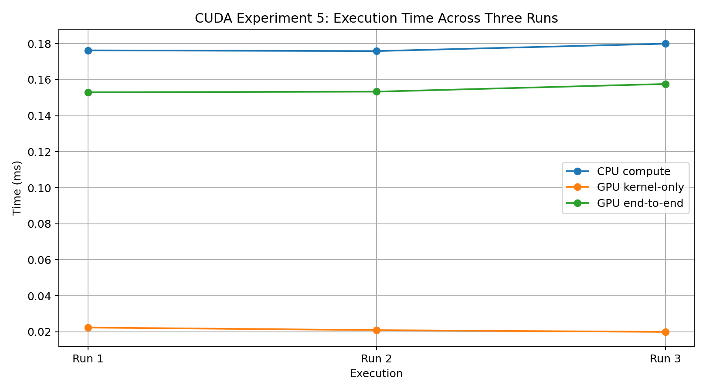
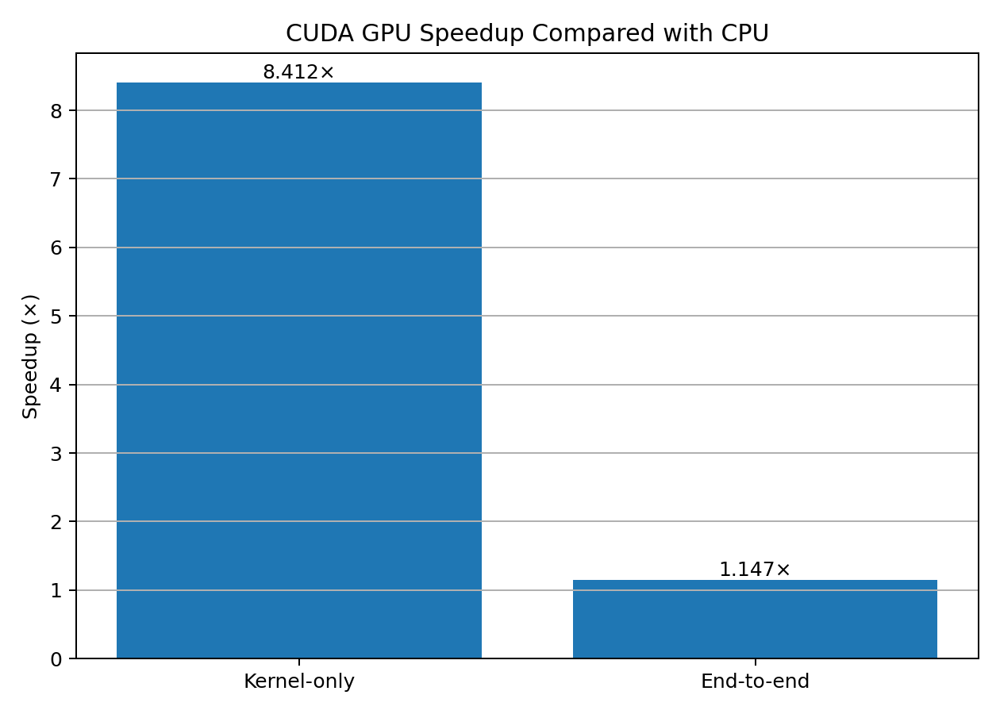
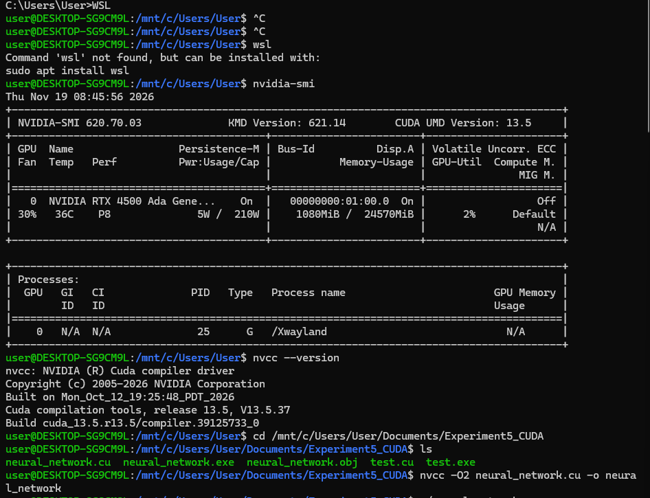
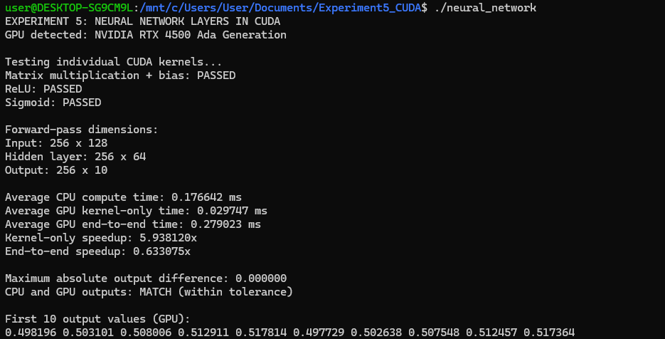
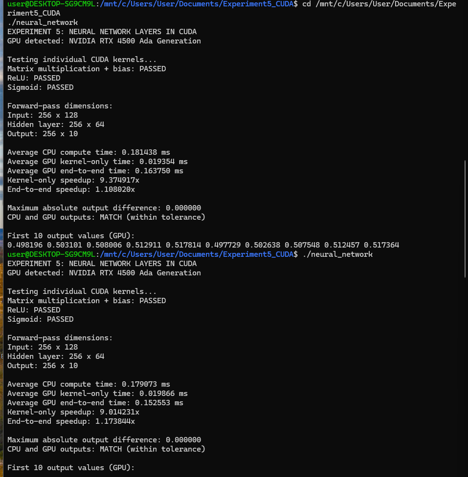
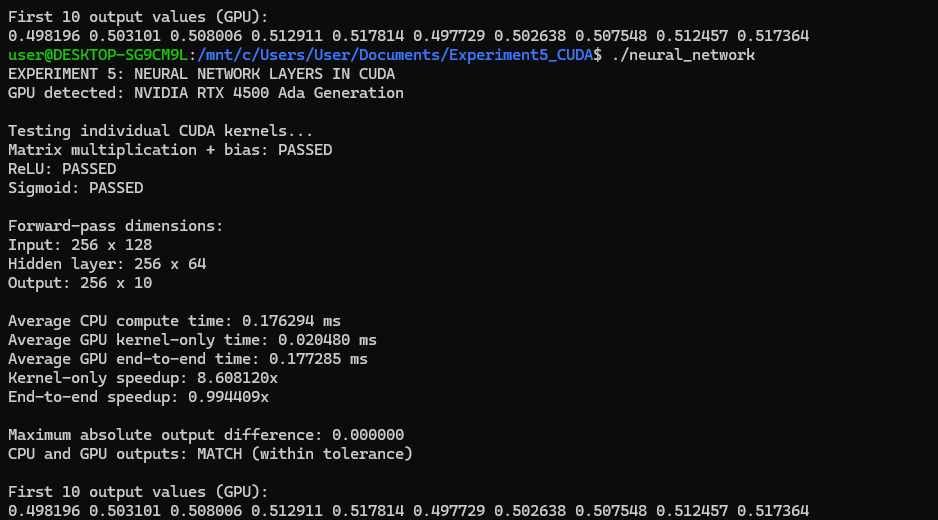
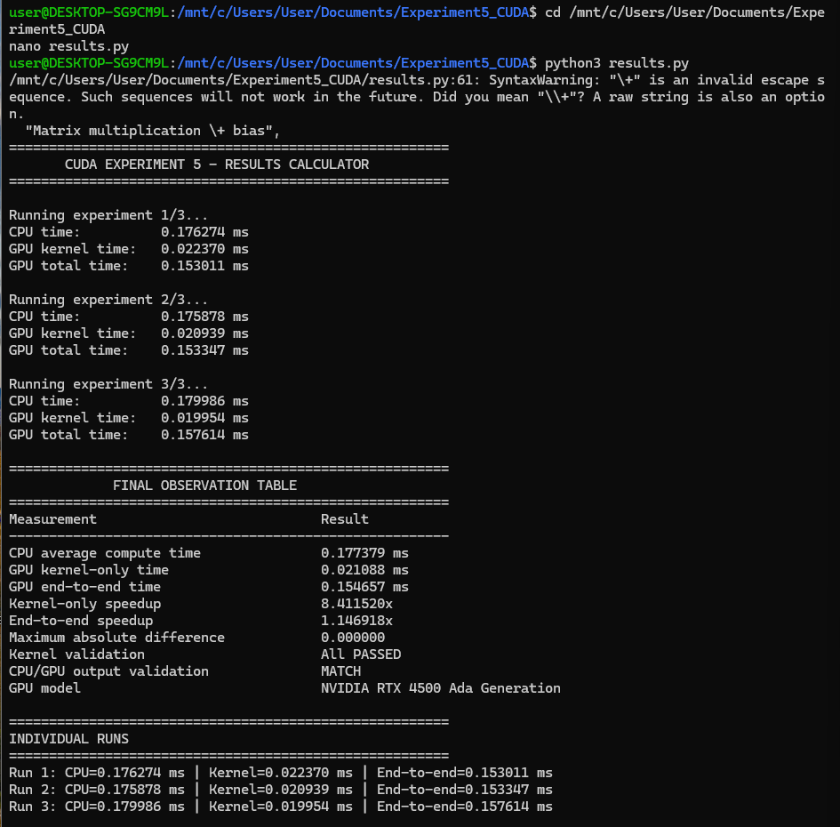
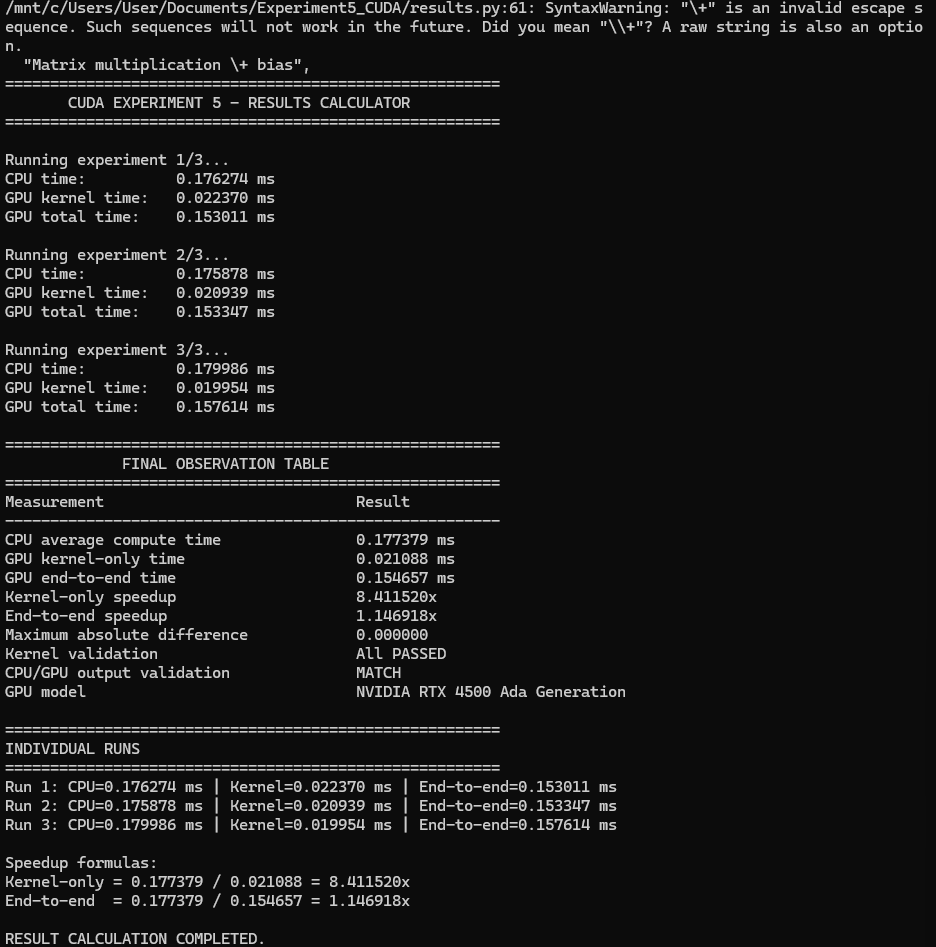
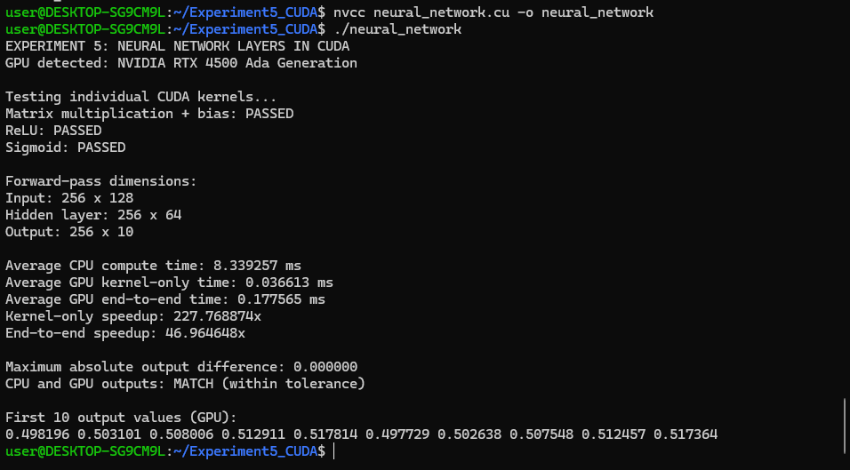

# CUDA Experiment 5 — Neural Network Layers

<p align="center">
  <b>GPU-Accelerated Neural Network Forward Pass Using Custom CUDA Kernels</b><br>
  NVIDIA RTX 4500 Ada Generation · CUDA Toolkit 13.5 · WSL Ubuntu
</p>

---

## 1. Experiment Overview

This experiment implements and evaluates a small fully connected neural network forward pass using custom CUDA kernels. The GPU implementation is compared against a CPU reference implementation to validate computational accuracy and measure performance differences.

### Operations Implemented

- Matrix multiplication with bias addition
- ReLU activation function
- Sigmoid activation function
- Two-layer neural network forward pass
- CPU and GPU output validation
- Execution time measurement and performance comparison

### Network Dimensions

| Stage | Dimensions |
|---|---:|
| Input batch | 256 × 128 |
| Hidden layer | 256 × 64 |
| Output layer | 256 × 10 |
| CPU/GPU repeats per timing | 20 |

The forward pass follows this sequence:

**Input → Matrix Multiplication → ReLU → Matrix Multiplication → Sigmoid → Output**

---

## 2. Development Environment

The experiment was implemented and executed using the following hardware and software configuration.

| Component | Configuration |
|---|---|
| GPU | NVIDIA RTX 4500 Ada Generation |
| CUDA Compiler | NVCC 13.5.37 |
| CUDA UMD | 13.5 |
| Execution Environment | WSL Ubuntu |
| NVIDIA Driver | 620.70.03 |

---

## 3. Repository Structure

```text
PGC-Experiment-5-CUDA/
├── src/
│   └── neural_network.cu
├── scripts/
│   └── results.py
├── results/
│   ├── graphs/
│   │   ├── execution_time_across_three_runs.png
│   │   └── gpu_speedup_comparison.png
│   └── tables/
│       ├── three_run_observations.csv
│       └── observation_tables_and_chart.xlsx
├── screenshots/
│   ├── 01_cuda_gpu_and_toolkit.png
│   ├── 02_cuda_program_execution.png
│   ├── 03_multiple_execution_output.png
│   ├── 04_repeat_run_output.png
│   ├── 05_three_run_results_calculator.png
│   ├── 06_final_observation_table.png
│   └── 07_initial_cuda_build_and_run.png
└── README.md
```

---

## 4. Compilation and Execution

### Step 1: Navigate to the Repository

Open the WSL Ubuntu terminal and navigate to the project directory.

```bash
cd PGC-Experiment-5-CUDA
```

### Step 2: Compile the CUDA Program

Compile the CUDA source file using NVCC with optimization enabled.

```bash
nvcc -O2 src/neural_network.cu -o neural_network
```

### Step 3: Execute the Program

Run the compiled executable.

```bash
./neural_network
```

The program performs the following operations:

- Checks GPU availability.
- Validates the three CUDA kernels.
- Executes the CPU and GPU forward passes.
- Measures execution times.
- Compares CPU and GPU outputs.
- Displays performance and validation results.

### Step 4: Generate Three-Run Observations

To generate an updated observation table, execute:

```bash
python3 scripts/results.py
```

The Python script executes the CUDA program three times, calculates average execution times and speedups, and generates the following CSV file:

```text
results/tables/three_run_observations.csv
```

---

## 5. Experimental Results

The following observations were recorded across three independent executions and used to generate the performance graphs.

### 5.1 Execution Time Observations

| Run | CPU Compute (ms) | GPU Kernel-Only (ms) | GPU End-to-End (ms) |
|---:|---:|---:|---:|
| 1 | 0.176274 | 0.022370 | 0.153011 |
| 2 | 0.175878 | 0.020939 | 0.153347 |
| 3 | 0.179986 | 0.019954 | 0.157614 |
| **Average** | **0.177379** | **0.021088** | **0.154657** |

### 5.2 Average Performance Comparison

| Metric | Result |
|---|---:|
| Kernel-Only Speedup | **8.411520×** |
| End-to-End Speedup | **1.146918×** |
| Maximum Absolute Output Difference | **0.000000** |
| Matrix Multiplication with Bias | PASSED |
| ReLU Activation | PASSED |
| Sigmoid Activation | PASSED |
| CPU/GPU Output Validation | MATCH |

### 5.3 Speedup Calculation

The speedup is calculated by dividing the average CPU execution time by the corresponding GPU execution time.

**Kernel-Only Speedup**

```text
CPU Average Compute Time / GPU Kernel-Only Time

= 0.177379 / 0.021088

= 8.411520×
```

**End-to-End Speedup**

```text
CPU Average Compute Time / GPU End-to-End Time

= 0.177379 / 0.154657

= 1.146918×
```

The measurements represent the three recorded executions. Actual execution times may vary depending on system load, GPU activity, and hardware conditions.

---

## 6. Performance Graphs

### 6.1 Execution Time Across Three Runs

The line graph compares CPU compute time, GPU kernel-only time, and GPU end-to-end execution time across the three recorded runs.



### 6.2 GPU Speedup Comparison

The bar graph compares the performance improvement achieved by GPU kernel execution alone against the complete GPU execution process.



---

## 7. Execution Screenshots

The following screenshots document the development environment, CUDA program execution, validation results, and performance observations.

### 7.1 GPU and CUDA Toolkit Verification



### 7.2 CUDA Program Execution



### 7.3 Multiple Execution Output



### 7.4 Repeat Execution Output



### 7.5 Three-Run Results Calculation



### 7.6 Final Observation Table



### 7.7 Initial CUDA Build and Execution



---

## 8. Result Analysis

The experiment produced the following observations:

1. All three individual CUDA kernel tests completed successfully.
2. The CPU and GPU implementations produced matching output values within the program's validation tolerance.
3. The GPU kernel-only execution achieved an average speedup of approximately 8.41× compared with CPU computation.
4. The end-to-end GPU execution achieved an average speedup of approximately 1.15×.
5. The difference between kernel-only and end-to-end performance is primarily due to additional data transfer, kernel launch, and synchronization overhead.
6. The kernel-only measurement excludes host-device data transfers because the input data and weights are already available in GPU memory.
7. The end-to-end measurement includes host-to-device transfers, kernel execution, synchronization, and output transfer.

These observations demonstrate that GPU computation can provide significant improvements in kernel execution time, although the overall performance gain depends on data transfer and execution overhead.

---

## 9. Conclusion

The experiment successfully implemented a two-layer fully connected neural network forward pass using custom CUDA kernels for matrix multiplication with bias addition, ReLU activation, and sigmoid activation.

The GPU implementation was validated against a CPU reference implementation, with all three kernel tests passing and matching output values.

Across the three recorded executions, the GPU achieved an average kernel-only speedup of **8.41×** and an end-to-end speedup of **1.15×** compared with CPU computation.

The experiment demonstrates the benefits of GPU acceleration for parallel neural network operations and highlights the importance of considering memory transfer and kernel execution overhead when evaluating overall GPU performance.

---

<p align="center">
  <b>CUDA Experiment 5 — Neural Network Layers</b><br>
  GPU Computing Laboratory
</p>
