# Softmax and Kernel Fusion in CUDA

**Parallel & Distributed Computing Laboratory** · KLE Technological University (KLETECH), Hubballi
**Team:** Mudit Nayak · Kartik · Manoj · Vinayak  ·  **Evaluation theme:** 10 (Softmax and Kernel Fusion)  ·  **Guide / date:** _[add guide name and date]_

A CUDA study of the row-wise softmax used in classifiers and attention: three separate kernels, a fused shared-memory kernel, an online (single-pass) kernel, a warp-per-row kernel, a fast-math variant and a PyTorch library baseline. Every kernel is verified against a CPU reference and timed with CUDA events over five experiments.

---

## Contents

1. [Problem](#1-problem)
2. [Kernel design](#2-kernel-design)
3. [Repository layout](#3-repository-layout)
4. [Test machine](#4-test-machine)
5. [Build and run, step by step](#5-build-and-run-step-by-step)
6. [Screenshots from the actual runs](#6-screenshots-from-the-actual-runs)
7. [Results (Python-generated)](#7-results-python-generated)
8. [Analysis](#8-analysis)
9. [Correctness](#9-correctness)
10. [Limitations](#10-limitations)
11. [Future work](#11-future-work)
12. [Troubleshooting](#12-troubleshooting)
13. [Other deliverables](#13-other-deliverables)

---

## 1. Problem

For each row x of a matrix, softmax(x)_i = exp(x_i - m) / sum_j exp(x_j - m), where m is the row maximum (subtracting m keeps exp() from overflowing). Each row needs two reductions (max, sum) and one element-wise pass. Done as separate kernels, the matrix travels through global memory several times; softmax does very little arithmetic per byte, so the layer is memory-bound and **kernel fusion** (fewer trips through memory) is the main optimisation. Softmax appears in every classifier output and in attention (one softmax per row of the QK^T score matrix).

## 2. Kernel design

| Variant | Global accesses per element | Idea |
|---|---|---|
| **Separate** (3 kernels) | 4 (read x three times, write y once) | `k_max`, `k_sumexp`, `k_norm`, one block per row, warp-shuffle + shared-memory block reduction |
| **Fused (shared memory)** | 2 (one read, one write) | One block per row; row cached in shared memory; max and sum use the same block reduction (C x 4 bytes of shared memory, up to 48 KB) |
| **Online softmax** | 3 | Running max and rescaled running sum in one pass, then one write pass (no shared-memory row cache) |
| **Warp-per-row** | 2 | One warp per row, 32 values per lane kept in registers, no `__syncthreads` (rows up to 1024 columns) |
| **Fused + `__expf`** | 2 | Fused kernel using the hardware fast exponential; accuracy trade-off measured |
| **PyTorch** `torch.softmax` | n/a | Library baseline (optional, `INSTALL_TORCH=1`) |

Timing: CUDA events, 3 warm-up runs, then the average of 30 runs. The "bytes moved" columns are ideal counts (accesses x elements x 4 bytes), used to compute effective bandwidth.

## 3. Repository layout

```
cuda_softmax_fusion/
├── Makefile                 make gpu ARCH=sm_120
├── PLAN.md                  project plan
├── README.md                this file (generated by scripts/make_readme.py)
├── src/
│   ├── kernels.cuh          all softmax kernels, block reductions, timing helper
│   └── bench.cu             benchmark driver: experiments, CPU verification, CSV output
├── scripts/
│   ├── run_all.sh           one command: build, run, figures, README, PPT, zip
│   ├── sweep.sh             runs all experiments, writes results/data.csv
│   ├── bench_torch.py       PyTorch baseline (optional)
│   ├── plot.py              figures and results/summary.md
│   ├── make_readme.py       generates this README
│   ├── make_ppt.py          generates the presentation
│   └── package.py           builds the results zip
├── results/                 CSVs, PNG figures, summary.md, logs, gpu.txt
├── docs/screenshots/        terminal screenshots (original and labelled)
└── presentation/            CUDA_Softmax_Kernel_Fusion.pptx
```

## 4. Test machine

| Item | Value |
|---|---|
| GPU | NVIDIA GeForce RTX 5060 Ti, 17.1 GB, 36 SMs, compute capability 12.0, L2 cache 32.0 MB |
| Driver | ? (nvidia-smi) |
| CUDA | nvcc release 13.3 (runtime 13030) |
| OS | Ubuntu on WSL2 (Windows 11) |
| Compiler flags | `nvcc -O3 -std=c++17 -arch=<ARCH> -lineinfo` |

## 5. Build and run, step by step

All commands run **inside WSL** (open "Ubuntu" or type `wsl` in PowerShell first).

**Step 1. Check the GPU is visible from WSL**

```bash
nvidia-smi
nvcc --version
```

**Step 2. Copy the project into the WSL home folder and enter it**

```bash
cp /mnt/c/Users/Intel/Downloads/cuda_softmax_fusion.zip ~/
cd ~ && unzip cuda_softmax_fusion.zip && cd cuda_softmax_fusion
```

(Replace `Intel` with your Windows user name: `ls /mnt/c/Users/` lists them.)

**Step 3. Build** (`sm_120` is RTX 50-series; `sm_89` RTX 40, `sm_86` RTX 30, or `ARCH=native`)

```bash
make gpu ARCH=sm_120
```

**Step 4. Run all experiments**

```bash
bash scripts/sweep.sh
```

**Step 5. Make figures, README and presentation** (or do everything above with `bash scripts/run_all.sh`)

```bash
pip install matplotlib pandas numpy python-pptx pillow   # once
python3 scripts/plot.py && python3 scripts/make_readme.py && python3 scripts/make_ppt.py
```

Optional PyTorch comparison: `INSTALL_TORCH=1 bash scripts/run_all.sh`.

## 6. Screenshots from the actual runs

### 6.0 GPU and CUDA environment (`nvidia-smi`, `nvcc --version`)

Saved by `run_all.sh` to `results/nvidia_smi.txt` and `results/nvcc_version.txt`:

```
Wed Nov 25 18:21:43 2026       
+-----------------------------------------------------------------------------------------+
| NVIDIA-SMI 610.57.01              KMD Version: 610.88        CUDA UMD Version: 13.3     |
+-----------------------------------------+------------------------+----------------------+
| GPU  Name                 Persistence-M | Bus-Id          Disp.A | Volatile Uncorr. ECC |
| Fan  Temp   Perf          Pwr:Usage/Cap |           Memory-Usage | GPU-Util  Compute M. |
|                                         |                        |               MIG M. |
|=========================================+========================+======================|
|   0  NVIDIA GeForce RTX 5060 Ti     On  |   00000000:02:00.0  On |                  N/A |
|  0%   35C    P5             12W /  180W |    1394MiB /  16311MiB |      3%      Default |
|                                         |                        |                  N/A |
+-----------------------------------------+------------------------+----------------------+

+-----------------------------------------------------------------------------------------+
| Processes:                                                                              |
|  GPU   GI   CI              PID   Type   Process name                        GPU Memory |
|        ID   ID                                                               Usage      |
|=========================================================================================|
|  No running processes found                                                             |
+-----------------------------------------------------------------------------------------+

nvcc: NVIDIA (R) Cuda compiler driver
Copyright (c) 2005-2026 NVIDIA Corporation
Built on Tue_Jun_09_02:43:40_PM_PDT_2026
Cuda compilation tools, release 13.3, V13.3.73
Build cuda_13.3.r13.3/compiler.38244171_0
```

### 6.1 Benchmark run: baseline sizes and row-length sweep

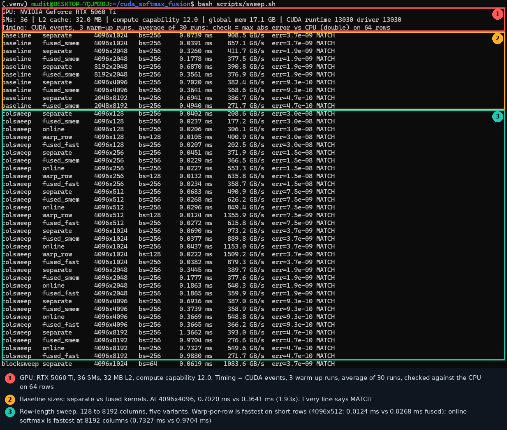

| Label | Meaning |
|---|---|
| 1 | GPU: RTX 5060 Ti, 36 SMs, 32 MB L2, compute capability 12.0. Timing = CUDA events, 3 warm-up runs, average of 30 runs, checked against the CPU on 64 rows |
| 2 | Baseline sizes: separate vs fused kernels. At 4096x4096, 0.7020 ms vs 0.3641 ms (1.93x). Every line says MATCH |
| 3 | Row-length sweep, 128 to 8192 columns, five variants. Warp-per-row is fastest on short rows (4096x512: 0.0124 ms vs 0.0268 ms fused); online softmax is fastest at 8192 columns (0.7327 ms vs 0.9704 ms) |

Original: [01_benchmark_run_baseline_and_colsweep_original.png](docs/screenshots/01_benchmark_run_baseline_and_colsweep_original.png)

### 6.2 Benchmark run: block-size sweep and DRAM-bound sizes

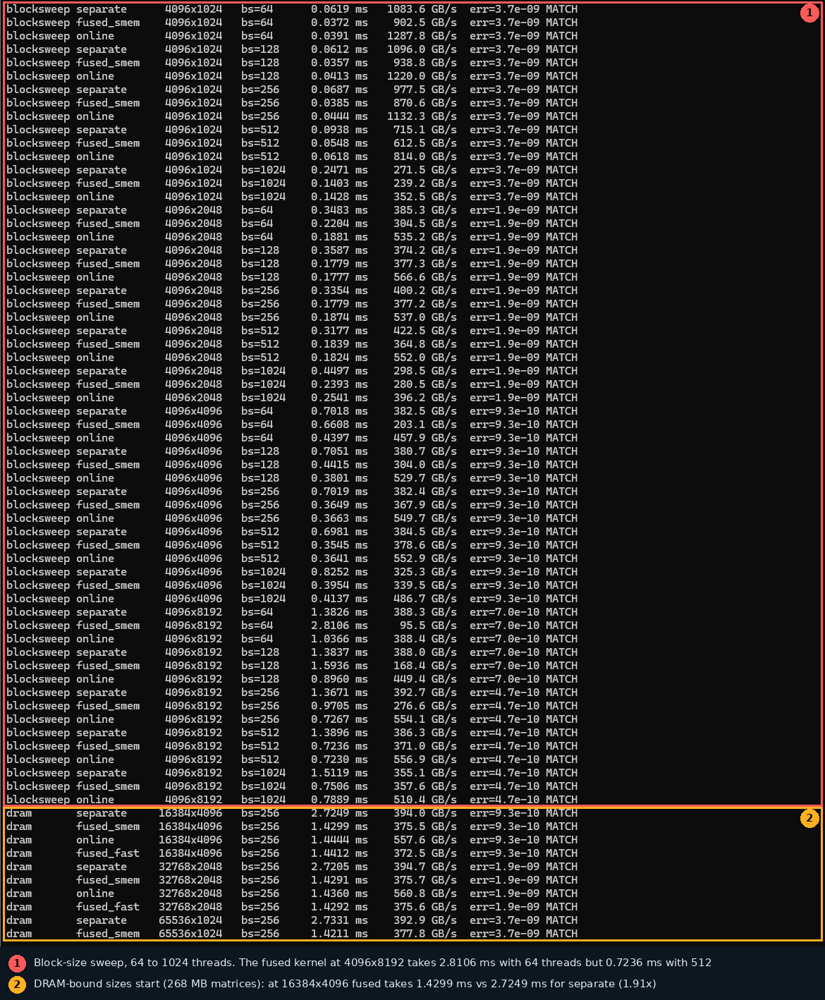

| Label | Meaning |
|---|---|
| 1 | Block-size sweep, 64 to 1024 threads. The fused kernel at 4096x8192 takes 2.8106 ms with 64 threads but 0.7236 ms with 512 |
| 2 | DRAM-bound sizes start (268 MB matrices): at 16384x4096 fused takes 1.4299 ms vs 2.7249 ms for separate (1.91x) |

Original: [02_benchmark_run_blocksweep_and_dram_original.png](docs/screenshots/02_benchmark_run_blocksweep_and_dram_original.png)

### 6.3 Benchmark run: DRAM-bound sizes, attention shapes, finish

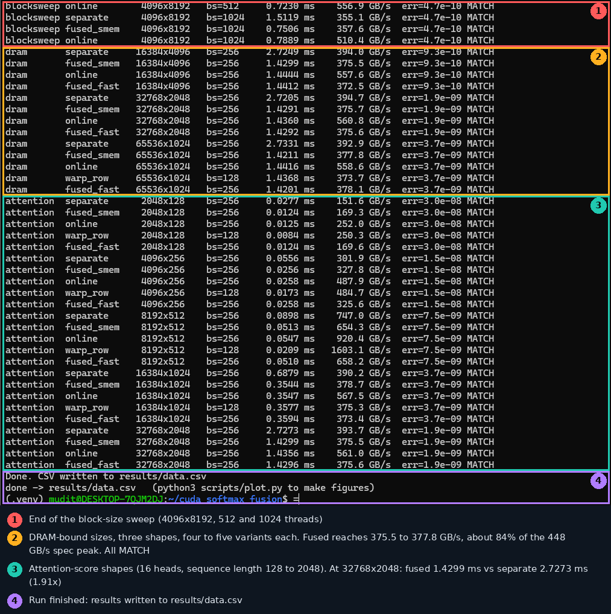

| Label | Meaning |
|---|---|
| 1 | End of the block-size sweep (4096x8192, 512 and 1024 threads) |
| 2 | DRAM-bound sizes, three shapes, four to five variants each. Fused reaches 375.5 to 377.8 GB/s, about 84% of the 448 GB/s spec peak. All MATCH |
| 3 | Attention-score shapes (16 heads, sequence length 128 to 2048). At 32768x2048: fused 1.4299 ms vs separate 2.7273 ms (1.91x) |
| 4 | Run finished: results written to results/data.csv |

Original: [03_benchmark_run_dram_attention_done_original.png](docs/screenshots/03_benchmark_run_dram_attention_done_original.png)

### 6.4 Figures, README, PPT and zip generated

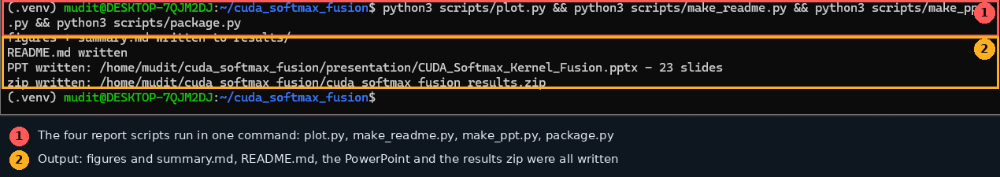

| Label | Meaning |
|---|---|
| 1 | The four report scripts run in one command: plot.py, make_readme.py, make_ppt.py, package.py |
| 2 | Output: figures and summary.md, README.md, the PowerPoint and the results zip were all written |

Original: [04_report_build_original.png](docs/screenshots/04_report_build_original.png)

## 7. Results (Python-generated)

All numbers below are produced by `scripts/plot.py` from `results/data.csv`; figures are in `results/`.

### Baseline sizes

| Rows x Cols | max | sum | norm | Separate | Fused | Speedup | Bytes sep (MB) | Bytes fused (MB) | Max err |
|---|---|---|---|---|---|---|---|---|---|
| 4096x1024 | 0.026 | 0.033 | 0.031 | 0.074 | 0.039 | 1.89x | 67.1 | 33.6 | 3.7e-09 |
| 4096x2048 | 0.041 | 0.039 | 0.188 | 0.326 | 0.178 | 1.83x | 134.2 | 67.1 | 1.9e-09 |
| 2048x8192 | 0.175 | 0.177 | 0.360 | 0.694 | 0.494 | 1.41x | 268.4 | 134.2 | 4.7e-10 |
| 4096x4096 | 0.186 | 0.167 | 0.360 | 0.702 | 0.364 | 1.93x | 268.4 | 134.2 | 9.3e-10 |
| 8192x2048 | 0.174 | 0.167 | 0.357 | 0.687 | 0.356 | 1.93x | 268.4 | 134.2 | 1.9e-09 |

### Row-length sweep (4096 rows, block 256)

| Cols | 3 separate kernels | Fused (shared memory) | Online softmax | Warp-per-row | Fused + __expf | PyTorch softmax |
|---|---|---|---|---|---|---|
| 128 | 0.040 | 0.024 | 0.021 | 0.010 | 0.021 | - |
| 256 | 0.045 | 0.023 | 0.023 | 0.013 | 0.023 | - |
| 512 | 0.068 | 0.027 | 0.030 | 0.012 | 0.027 | - |
| 1024 | 0.069 | 0.038 | 0.044 | 0.022 | 0.038 | - |
| 2048 | 0.344 | 0.178 | 0.186 | - | 0.186 | - |
| 4096 | 0.694 | 0.374 | 0.367 | - | 0.367 | - |
| 8192 | 1.366 | 0.970 | 0.733 | - | 0.988 | - |

### Block-size sweep (fused kernel)

| Cols | Best block | Best ms | Worst block | Worst ms |
|---|---|---|---|---|
| 1024 | 128 | 0.036 | 1024 | 0.140 |
| 2048 | 128 | 0.178 | 1024 | 0.239 |
| 4096 | 512 | 0.354 | 64 | 0.661 |
| 8192 | 512 | 0.724 | 64 | 2.811 |

### expf vs __expf (fused kernel)

| Cols | expf ms | expf err | __expf ms | __expf err | gain |
|---|---|---|---|---|---|
| 128 | 0.024 | 3.0e-08 | 0.021 | 3.0e-08 | 1.14x |
| 256 | 0.023 | 1.5e-08 | 0.023 | 1.5e-08 | 0.98x |
| 512 | 0.027 | 7.5e-09 | 0.027 | 7.5e-09 | 0.98x |
| 1024 | 0.038 | 3.7e-09 | 0.038 | 3.7e-09 | 0.99x |
| 2048 | 0.178 | 1.9e-09 | 0.186 | 1.9e-09 | 0.95x |
| 4096 | 0.374 | 9.3e-10 | 0.367 | 9.3e-10 | 1.02x |
| 8192 | 0.970 | 4.7e-10 | 0.988 | 4.7e-10 | 0.98x |

### Figures

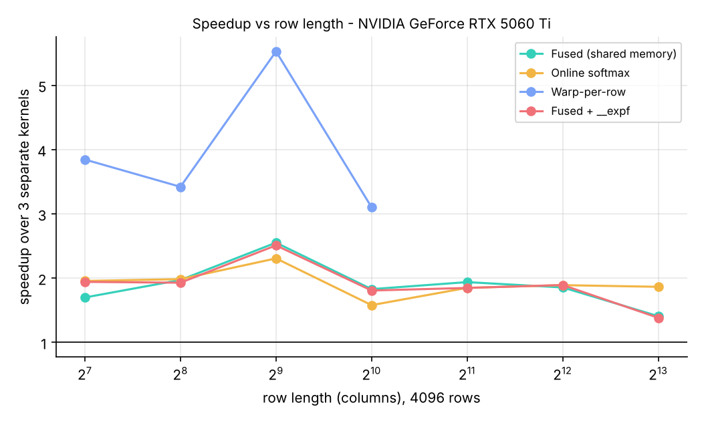

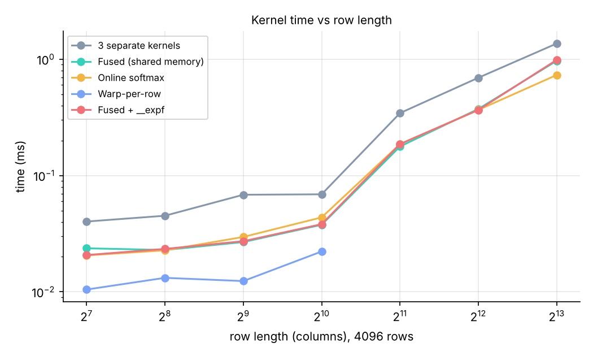

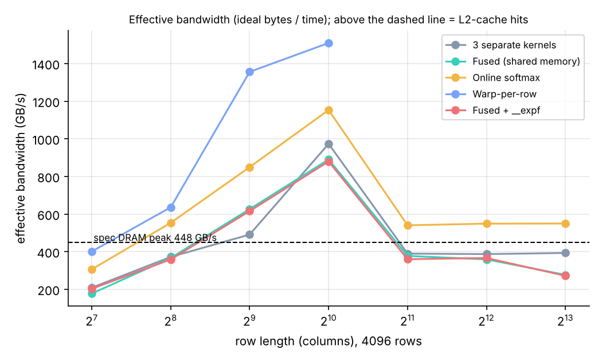

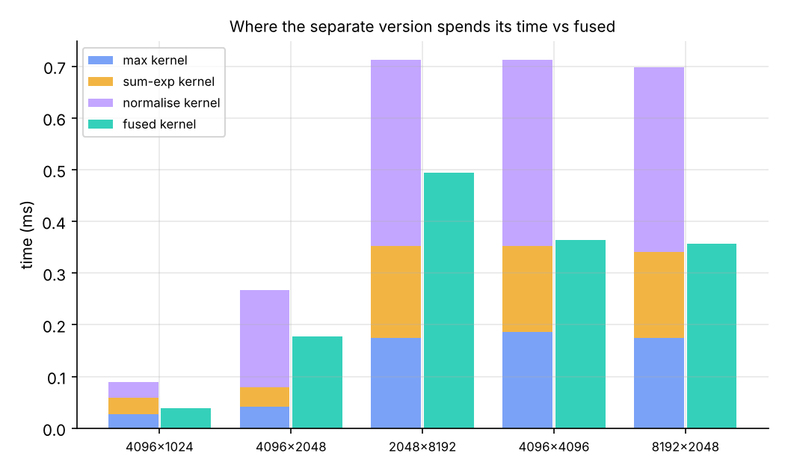

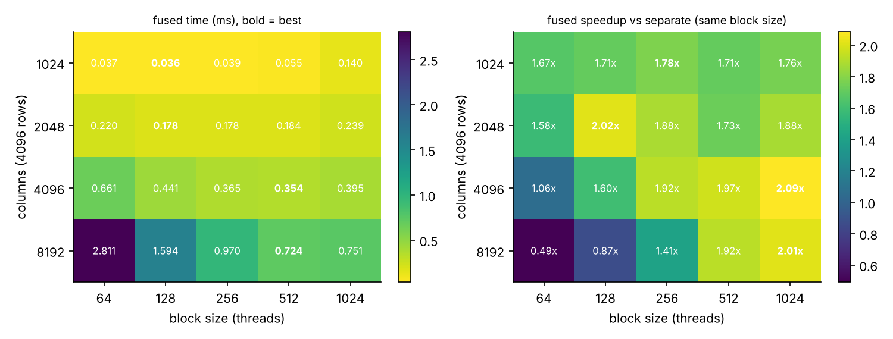

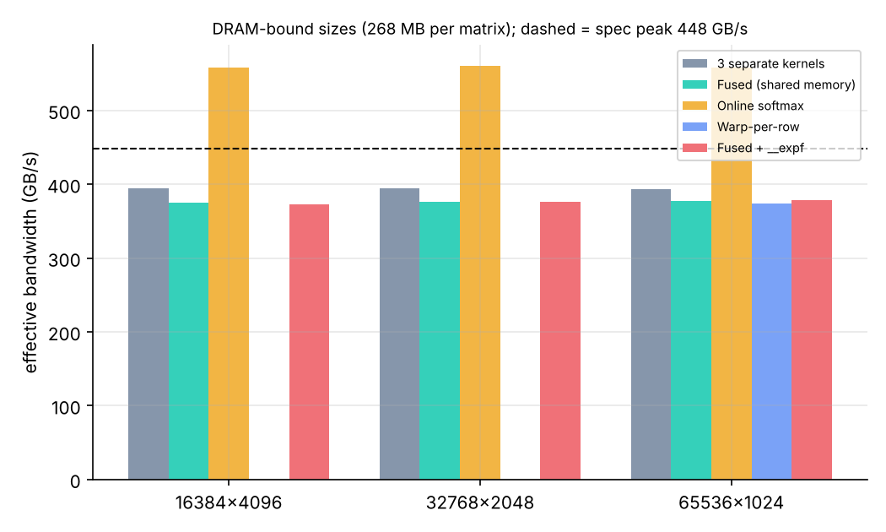

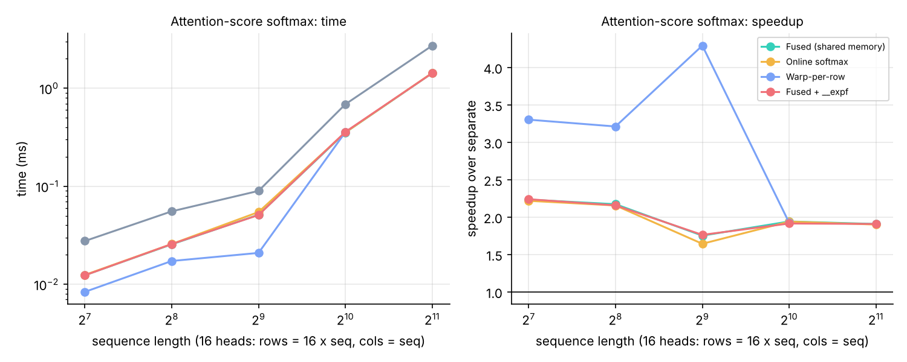

## 8. Analysis

- Fusing the three kernels into one gave 1.41x to 1.93x on the baseline sizes. Ideal global-memory traffic falls from 4 accesses per element to 2, so about 2x is the expected ceiling for a memory-bound layer.
- Across row lengths 128 to 8192 the fused speedup ranges from 1.41x (at 8192 columns) to 2.55x (at 512 columns).
- Fastest variant per row length: 128 cols: Warp-per-row, 256 cols: Warp-per-row, 512 cols: Warp-per-row, 1024 cols: Warp-per-row, 2048 cols: Fused (shared memory), 4096 cols: Fused + __expf, 8192 cols: Online softmax. Differences under about 3% (for example fused vs fused + __expf) are within run-to-run noise.
- Warp-per-row (registers, no __syncthreads) against the shared-memory fused kernel on short rows: 128 cols 2.26x, 256 cols 1.74x, 512 cols 2.17x, 1024 cols 1.70x (above 1 means warp-per-row is faster).
- Online softmax (one pass for max and sum, 3 nominal accesses per element) is 1.58x to 2.31x faster than separate kernels. Against the shared-memory fused kernel its time is 0.76x to 1.16x (below 1 means online is faster): it wins at 128, 8192 columns, ties (within 3%) at 256, 4096.
- Best block size of the fused kernel: 1024 cols -> 128 threads, 2048 cols -> 128 threads, 4096 cols -> 512 threads, 8192 cols -> 512 threads.
- On DRAM-bound sizes (268 MB per matrix) the fused kernel reaches 375 to 378 GB/s effective bandwidth, up to 84% of the 448 GB/s spec peak.
- Some DRAM-sized runs report more than the 448 GB/s peak (up to 561 GB/s, online). Effective bandwidth uses nominal accesses per element; a variant that reads the same row twice gets the second read from cache, so nominal bytes overstate its real DRAM traffic. Compare variants by time, and use the fused kernel's figure as the DRAM estimate.
- At small sizes the effective bandwidth rises to 1509 GB/s, above the DRAM peak. The matrix fits in the GPU's L2 cache and the timing loop re-reads it from there, so these numbers show cache speed, not DRAM speed.
- Replacing expf with __expf changed the fused time by 0.95x to 1.14x, with a worst error of 3.0e-08 against 3.0e-08 for expf. The median change is 0.98x, i.e. no consistent gain, which fits a memory-bound layer: a cheaper exponential does not help when the kernel waits on memory.
- Correctness: 139 kernel runs were compared with a double-precision CPU softmax on 64 rows each; the worst maximum absolute error is 3.0e-08 (all MATCH).

Derived quantities (bytes moved / time) are estimates based on ideal traffic, not hardware counters. Reasons given for trends (for example shared-memory pressure on long rows) are hypotheses until confirmed with Nsight Compute.

## 9. Correctness

Every kernel output is compared with a double-precision CPU softmax on the first 64 rows of each matrix (the output buffer is zeroed before each kernel so stale data cannot pass). Result: **all runs MATCH**, worst maximum absolute error **3.0e-08** over 139 verified runs (threshold 1e-5).

## 10. Limitations

- One GPU, one machine; synthetic uniform random data in [-10, 10], not real model activations.
- Each configuration is timed as a loop of 30 launches on the same data, so matrices that fit in the L2 cache are served from cache; the DRAM-bound experiment uses 268 MB matrices to avoid this.
- Per-kernel times of the separate version are measured standalone (each kernel looped on its own); their sum can differ slightly from the measured sequence time.
- Only the first 64 rows are verified against the CPU, to keep the 268 MB cases practical.
- The fused kernel needs the row in shared memory (at most 12,288 columns); longer rows need a fallback.
- Run-to-run variance exists (other processes, GPU clocks); results should be read as ranges, not exact constants.

## 11. Future work

- Register/shared-memory hybrid and vectorised (`float4`) loads for the fused kernel.
- A fallback for rows longer than shared memory (two-pass or online with block cooperation across rows).
- Fusing softmax into the attention score computation so the score matrix is never written (FlashAttention-style).
- Profile with Nsight Compute (DRAM throughput, achieved occupancy) to confirm the explanations above.

## 12. Troubleshooting

| Symptom | Fix |
|---|---|
| `nvidia-smi: command not found` in WSL | Update the Windows NVIDIA driver and run `wsl --update`; do not install a Linux driver inside WSL |
| `nvcc: command not found` | `export PATH=/usr/local/cuda/bin:$PATH` (add to `~/.bashrc`) |
| `no kernel image is available` | Wrong `ARCH`; use `ARCH=sm_120` for RTX 50, or `ARCH=native` |
| `python3 -m venv` fails | `sudo apt install python3-venv` |
| PyTorch says CUDA unavailable | Install the `cu128` build: `INSTALL_TORCH=1 bash scripts/run_all.sh` |
| Results look noisy | Close games and browser tabs with video; rerun |

## 13. Other deliverables

- `presentation/CUDA_Softmax_Kernel_Fusion.pptx` - slide deck with the measured results.
- `results/` - raw CSV, logs and all figures; `results/summary.md` has the tables.
